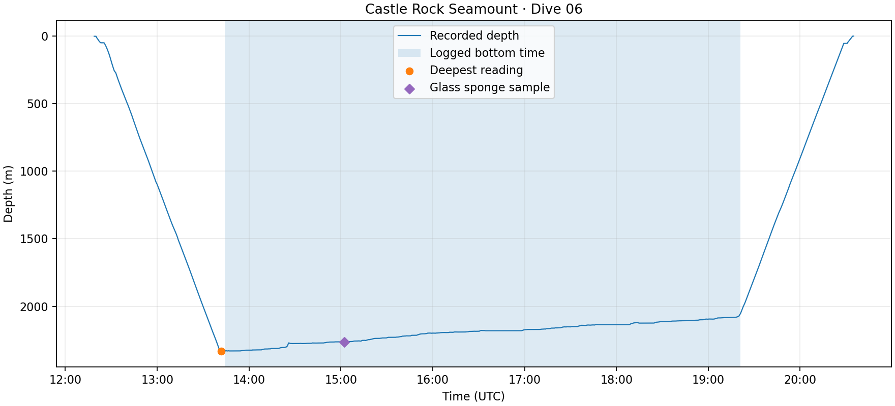
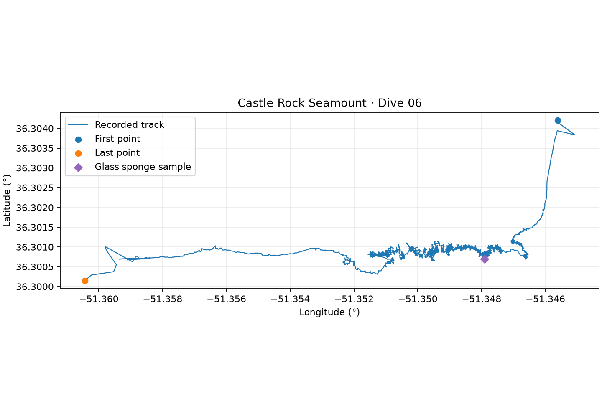
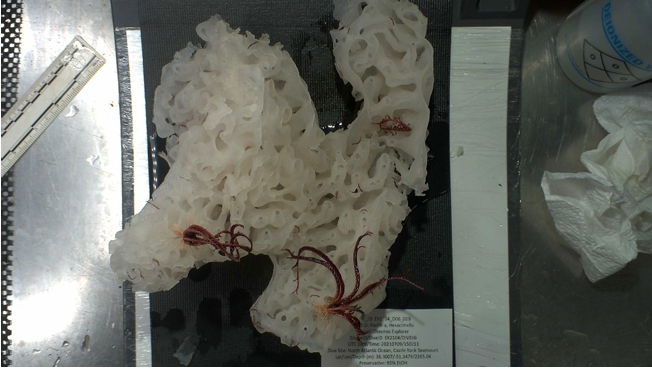

# Castle Rock Dive Replay

An interactive replay of NOAA's Deep Discoverer ROV dive at Castle Rock
Seamount on July 9, 2021. A shared timeline links the vehicle's depth
profile to its latitude and longitude. The **Jump to sponge** button
takes you to the logged glass sponge collection at 15:02:11 UTC.

## Dive preview







*Glass sponge sample `EX2104_D06_02B`, collected at 15:02:11 UTC at a
reported depth of 2,265 m. Photo credit
[NOAA Ocean Exploration](https://repository.library.noaa.gov/view/noaa/32356/noaa_32356_DS1.pdf#page=9).*

## Run locally

Requires Python 3.12 or newer and [uv](https://docs.astral.sh/uv/).
Run these commands from the project root:

```bash
mkdir -p data/raw

curl -fL -o data/raw/EX2104_DIVE06_Path.kml \
  https://oer.hpc.msstate.edu/okeanos/ex2104/EX2104_DIVE06_Path.kml

curl -fL -o data/raw/ex2104-DIVE06-ancillary-data.zip \
  https://oer.hpc.msstate.edu/okeanos/ex2104/ex2104-DIVE06-ancillary-data.zip

uv run --with matplotlib python experiments/02_plot_dive_depth.py --interactive
```

## Experiments

| Script | Result |
| --- | --- |
| `01_plot_dive_track.py` | Plots the 1,978-point KML route. |
| `02_plot_dive_depth.py` | Exports a depth chart by default. Use `--interactive` for the synchronized map and timeline. |
| `03_locate_sponge_sample.py` | Compares the closest complete navigation reading with the logged sponge sample. |

Run the third experiment with `uv run python experiments/03_locate_sponge_sample.py`.

## Validation

- The deepest of 29,766 depth readings was **2,331.3 m**, matching the dive report to its displayed precision.
- The closest complete navigation reading was **0.127 s after** the sponge event, **0.95 m** from the reported coordinates, and **2.04 m shallower** than the reported sample depth. These offsets measure agreement between the records. Absolute positioning accuracy remains unknown.

Data source: [NOAA Ocean Exploration, EX2104 Dive 06](https://www.ncei.noaa.gov/waf/okeanos-rov-cruises/ex2104/).
